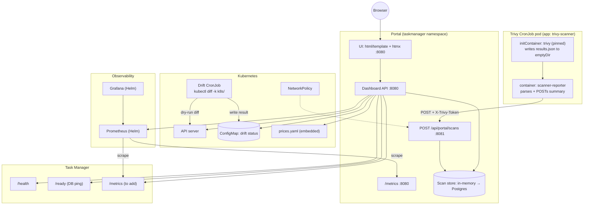

# FinOps & SecOps Portal — Handoff Plan

> **Purpose.** Self-contained plan and architecture for continuing this project in a
> fresh session. Read this file first; it records what already exists, what was
> verified, what was decided, what must be built, and which traps to avoid.
>
> **Project root:** `terraform_grafana_trivy/`
> **Go module:** `github.com/h4r5h6l/kubernetes_demo`
> **Target runtime:** Minikube (Calico CNI) + Kubernetes manifests (kustomize)
> **Status:** Portal skeleton exists; deployment, security, drift, cost, Trivy,
> Prometheus/Grafana, and Terraform are not implemented yet.

---

## 0. Confirmed decisions

These were explicitly chosen and should not be re-litigated without cause.

| Topic | Decision | Consequence |
|---|---|---|
| p95 latency / error rate | **Option (a): Prometheus + Grafana via Helm** | Must instrument both binaries, install Prometheus, query its HTTP API, provision a Grafana dashboard. |
| Cost RBAC | **Drop `nodes`; stay namespace-scoped** | Cost uses pod requests × embedded `prices.yaml`. No ClusterRole for nodes. |
| Frontend | **Go `html/template` + htmx** | No npm build. htmx JS is vendored and embedded. |
| Terraform | **Required; add `terraform/`** | Scope still needs confirmation (see §15). |

### Constraints already agreed

- Ingest and dashboard are split onto **two ports** because NetworkPolicy is
  port/pod granular, not HTTP-path granular.
- The Trivy token is **never committed**; a Makefile target creates the Secret.
- `kubectl diff` is a **server-side dry-run apply**, not read-only.
- Minikube must run with `--cni=calico`; the default CNI does not enforce
  NetworkPolicy.
- Portal readiness must not be faked: it should reflect the task manager’s DB
  readiness.

---

## 1. Verified repository snapshot

Checked with `go build ./...`, `go vet ./...`, `go test ./...`, `go mod tidy -diff`.

| Check | Result |
|---|---|
| `go build ./...` | passes |
| `go vet ./...` | passes |
| `go test ./...` | passes, but **no tests under `cmd/portal`** |
| `go mod tidy -diff` | **fails cleanliness**: `prometheus/client_golang` is direct but marked `// indirect`; missing `go.sum` entries |
| Git | directory is **not a git repository**; no `.gitignore` |
| Local toolchain | Go 1.27.3, Docker 29.10, kubectl 1.35.10 (kustomize 5.7.1), minikube 1.39 |
| Missing locally | `helm`, `terraform`, `trivy`, standalone `kustomize` |

### Files that already exist

```text
cmd/server/                 existing task manager entry point
cmd/portal/                 Portal skeleton (main, config, handlers, store)
internal/config/            task manager config
internal/database/          pgx pool + advisory-locked migrations
internal/httpx/             health/ready + JSON error helpers
internal/task/              model, repository, API handler + tests
migrations/                 embedded SQL migrations
web/                        existing server-rendered UI (pattern to copy)
k8s/                        app, Postgres, Service, Ingress, ConfigMap, HPA, Secret
loadtest/                   k6 scripts and committed acceptance evidence
Dockerfile                  builds ONLY ./cmd/server
docker-compose.yaml         app + Postgres only
Makefile                    app build/test/k8s targets only
ARCHITECTURE.md             target design (ahead of implementation)
README.md                   task-manager-only documentation
```

### Portal skeleton — current behaviour

| Location | Implemented |
|---|---|
| `cmd/portal/main.go:50-75` | Primary server on `PORT` (8080) with `/metrics`; ingest server on `INGEST_PORT` (8081) with only `POST /api/portal/scans` |
| `cmd/portal/handlers/handlers.go:213-245` | Token auth via `crypto/subtle`, 2 MiB `MaxBytesReader`, `201 Created` |
| `cmd/portal/store/store.go` | `Store` interface + bounded in-memory implementation (max 100) |
| `cmd/portal/config/config.go` | Port and `TASK_MANAGER_URL` validation |

### What is still a stub

| Endpoint | Current state |
|---|---|
| `GET /api/portal/drift` | Hard-coded `{"status":"unknown"}` (`handlers.go:174-180`) |
| `GET /api/portal/cost` | Hard-coded zero estimate (`handlers.go:182-189`) |
| `GET /` | JSON endpoint list, **not an HTML dashboard** (`handlers.go:196-211`) |
| `/metrics` | Default Go/runtime metrics only; no request or latency metrics |
| `GET /api/portal/scans/{id}` | Not implemented; `store.Store` has no `Get` |

---

## 2. Target architecture



### Port map

| Port | Server | Purpose | Exposure |
|---|---|---|---|
| `8080` | Portal primary | UI, dashboard API, `/health`, `/ready`, `/metrics` | Browser, ingress, Prometheus, in-cluster |
| `8081` | Portal ingest | `POST /api/portal/scans` only | Only pods labeled `app: trivy-scanner` |
| `80` | `taskmanager` Service | Existing app Service → container `8080` | Ingress / Portal |
| `8080` | Task manager container | App UI/API | Portal calls via Service |

**Important:** the Portal and the task manager both default to `8080`. Any local
compose/dev setup must remap one of them (e.g. Portal host port `8082`).

---

## 3. Data flows

1. **Health.** Portal `GET /api/portal/health` calls task manager `/ready`
   (DB-aware) and `/health`. Dashboard shows app + DB + Portal status.
2. **Security.** Trivy CronJob writes `results.json`; parser reduces it to a
   summary; `POST /api/portal/scans` on `:8081` stores it. Dashboard reads the
   latest summary from the store.
3. **Drift.** CronJob runs `kubectl diff` against `kustomize build k8s/`,
   captures the diff, and writes status/detail to a ConfigMap. Portal reads that
   ConfigMap through its ServiceAccount.
4. **Cost.** Portal lists pods in `taskmanager`, sums CPU/memory **requests**,
   multiplies by embedded `prices.yaml`, and returns an AKS-equivalent estimate.
5. **Observability.** Prometheus scrapes task manager and Portal `/metrics`;
   Portal queries the Prometheus HTTP API for p95 and error rate; Grafana reads
   Prometheus.

---

## 4. API contract

| Method | Path | Port | Auth | Purpose |
|---|---|---|---|---|
| `GET` | `/health` | 8080 | none | Portal liveness (no dependencies) |
| `GET` | `/ready` | 8080 | none | Portal readiness; must call task manager `/ready` |
| `GET` | `/metrics` | 8080 | none | Prometheus metrics |
| `GET` | `/` | 8080 | none | HTML dashboard (templates + htmx) |
| `GET` | `/api/portal/summary` | 8080 | none | Aggregate dashboard payload |
| `GET` | `/api/portal/health` | 8080 | none | App + DB + Portal health |
| `GET` | `/api/portal/security` | 8080 | none | Latest scan summary |
| `GET` | `/api/portal/drift` | 8080 | none | Drift status from ConfigMap |
| `GET` | `/api/portal/cost` | 8080 | none | Estimated monthly spend |
| `GET` | `/api/portal/scans` | 8080 | none | List stored scans |
| `GET` | `/api/portal/scans/{id}` | 8080 | none | Retrieve one scan |
| `POST` | `/api/portal/scans` | **8081** | `X-Trivy-Token` + NetworkPolicy | Ingest parsed Trivy summary |

### Ingest request shape

```json
{
  "scan_id": "uuid-or-generated",
  "scanned_at": "2026-11-19T00:00:00Z",
  "image": "ghcr.io/<owner>/taskmanager:<tag>",
  "severity": {"critical": 0, "high": 1, "medium": 2, "low": 3},
  "top_findings": [
    {"target": "binary", "vuln_id": "CVE-...", "severity": "HIGH", "title": "..."}
  ]
}
```

Validation requirements (not yet implemented):

- `http.MaxBytesReader` (already present).
- `json.Decoder.DisallowUnknownFields()`.
- Reject trailing JSON.
- Require non-empty `image`; generate `scan_id` server-side if absent.
- Severity counts must be `>= 0`.
- Cap `top_findings` (e.g. 20) and string lengths.
- Compare token as `sha256(header) == sha256(secret)` using
  `subtle.ConstantTimeCompare` to avoid the length leak in the current
  `constantTimeCompare` (`handlers.go:247-249`).

---

## 5. Kubernetes resources to create

| Manifest | Kind | Notes |
|---|---|---|
| `k8s/portal-deployment.yaml` | Deployment | Dual ports 8080/8081; non-root; read-only rootfs; drop ALL caps; `automountServiceAccountToken: true`; `replicas: 1` until Postgres store |
| `k8s/portal-service.yaml` | Service | ClusterIP, ports `http` 8080 and `ingest` 8081 |
| `k8s/portal-configmap.yaml` | ConfigMap | `TASK_MANAGER_URL`, `PROM_URL`, `PRICES_MODE`, `LOG_LEVEL`, token env name |
| `k8s/portal-rbac.yaml` | ServiceAccount + Role + RoleBinding | Read-only `get/list/watch` on `pods`, `deployments`, `configmaps` in `taskmanager` |
| `k8s/portal-networkpolicy.yaml` | NetworkPolicy | See warning below |
| `k8s/trivy-secret.example.yaml` | Secret example | Template only; no real token |
| `k8s/trivy-cronjob.yaml` | CronJob | initContainer Trivy + parser container |
| `k8s/drift-cronjob.yaml` | CronJob | Own SA; diff `kustomize build k8s/`; write ConfigMap |
| `k8s/ingress.yaml` | Update | Optional `portal.taskmanager.local` host |
| `k8s/kustomization.yaml` | Update | Add every new resource |

### NetworkPolicy — critical correction

A NetworkPolicy that selects the Portal pod isolates it: **all ingress not
explicitly allowed is denied.** A policy allowing only `8081` from
`app: trivy-scanner` would also block the dashboard on `8080`.

The policy must include, at minimum:

```yaml
ingress:
  - from:
      - podSelector:
          matchLabels:
            app: trivy-scanner
    ports:
      - port: 8081
        protocol: TCP
  - from:
      - namespaceSelector: {}      # or ingress-nginx / monitoring namespaces
    ports:
      - port: 8080
        protocol: TCP
```

Also define **egress** if any default-deny egress policy exists: DNS (`53`),
task manager (`80`), Kubernetes API (`443`), Prometheus (`9090`).

### Ingress

The current `k8s/ingress.yaml` routes `taskmanager.local` to the task manager
Service only. The Portal needs its own host or path. Do **not** expose `8081`
through the Ingress.

### Drift CronJob — RBAC reality

`kustomize build k8s/` currently emits:

- `Namespace` — **cluster-scoped**; a namespaced Role cannot read it.
- `Secret` — diffing it requires `get` on secrets.
- `Deployment`, `StatefulSet`, `Service`, `ConfigMap`, `Ingress`, `HPA`.

Therefore, either:

- **Option A (recommended):** diff a filtered manifest that excludes
  `namespace.yaml` and `secret.yaml`, keeping the CronJob namespace-scoped; or
- **Option B:** grant a ClusterRole for namespace/secret read plus dry-run verbs.

Additional drift requirements:

- The drift SA needs **write** access to its own result ConfigMap
  (`create`/`patch`/`update` on `configmaps`) — separate from the Portal’s
  read-only Role.
- `kubectl diff` exits **1 when differences exist**; treat exit 1 as success.
- Truncate diff output to stay below the ConfigMap 1 MiB limit.
- The CronJob image must contain `kubectl` (built-in kustomize is available via
  `kubectl kustomize`; standalone `kustomize` is not installed locally).
- The manifests must be available inside the image (bake them in or mount a
  ConfigMap).

### Trivy CronJob

```text
CronJob trivy-scan (daily, pinned image)
├── initContainer: trivy
│   ├── image: aquasec/trivy:<PINNED>
│   ├── trivy image --format json --output /scan/results.json <PULLABLE_IMAGE>
│   ├── TRIVY_CACHE_DIR=/scan/cache (emptyDir)
│   └── needs internet for the Trivy DB
└── container: scanner-reporter
    ├── image: <portal image> (must be built from this repo)
    ├── reads /scan/results.json
    ├── POSTs summary to http://portal:8081/api/portal/scans
    └── header X-Trivy-Token from Secret
```

Additional requirements:

- **The scanned image must be pullable.** `taskmanager:latest` only exists after
  `minikube image load`; Trivy in a pod cannot see it. Push to GHCR or run a
  local registry.
- If the image is private, add `imagePullSecrets` to the CronJob.
- Store only the summary, not the full JSON.
- Set `concurrencyPolicy: Forbid`, `restartPolicy: Never`, a deadline, and
  `--exit-code 0` so findings do not fail the Job.
- Add `--scanners vuln` to avoid secret/misconfig noise.
- The parser must be a real Go binary (or a tested script); golden-file test
  required.

---

## 6. Security model

| Control | Implementation |
|---|---|
| Token | `X-Trivy-Token`, generated at deploy time, stored in `trivy-ingest-token` Secret |
| Comparison | SHA-256 both values, then `subtle.ConstantTimeCompare` |
| Network | NetworkPolicy restricts `8081` to `app: trivy-scanner`; `8080` allowed separately |
| Body size | `http.MaxBytesReader` 2 MiB (already present) |
| JSON | `DisallowUnknownFields`, no trailing data, field validation |
| RBAC | Portal read-only on `pods`, `deployments`, `configmaps`; drift SA separate |
| Pod hardening | non-root, read-only rootfs, drop ALL caps, `allowPrivilegeEscalation: false`, `seccompProfile: RuntimeDefault` |
| Secret hygiene | commit only `k8s/trivy-secret.example.yaml`; add `.gitignore` entry |

Makefile target to add:

```make
k8s-create-trivy-secret:
	kubectl -n taskmanager create secret generic trivy-ingest-token \
	  --from-literal=token=$$(openssl rand -hex 32) \
	  --dry-run=client -o yaml | kubectl apply -f -
```

`k8s-up` must create the Secret before applying the CronJob, or the Job will
fail to start.

**Note:** the repo is not yet a git repository and has no `.gitignore`. Create
one before any commit, including `k8s/trivy-secret.yaml` and `.env`.

---

## 7. Observability (p95 decision)

Chosen: **Prometheus + Grafana via Helm.**

Required work:

1. Instrument the task manager with `prometheus/client_golang`:
   - request counter by method/route/status,
   - latency histogram by route,
   - expose `/metrics`.
2. Instrument the Portal the same way (replace the bare `promhttp.Handler()`).
3. Add scrape configuration. Simplest on Minikube: pod annotations
   (`prometheus.io/scrape`, `prometheus.io/port`, `prometheus.io/path`) rather
   than `ServiceMonitor` CRDs.
4. Add `PROM_URL` to Portal config and query:
   - p95: `histogram_quantile(0.95, sum by (le) (rate(http_request_duration_seconds_bucket[5m])))`
   - error rate: `sum(rate(http_requests_total{status=~"5.."}[5m])) / sum(rate(http_requests_total[5m]))`
5. If Prometheus is unavailable, return `"unavailable"` — **never** `0`.
6. Provision at least one Grafana dashboard JSON (ConfigMap or provisioning
   files) covering app latency, error rate, pod restarts, and Portal health.

A single `/metrics` scrape cannot produce recent p95; it only exposes cumulative
histogram buckets. The Portal must query Prometheus over a time window.

---

## 8. Cost estimator

- Read pod CPU/memory **requests** from the Kubernetes API in `taskmanager`.
- Ignore node capacity (decision: no ClusterRole).
- Multiply by embedded `prices.yaml` (AKS-equivalent hourly/monthly rates).
- Return `{estimate_usd, currency, source, detail, generated_at}` and label it
  an estimate, not a bill.
- Options for the Kubernetes client:
  - `k8s.io/client-go` (correct but heavy), or
  - a minimal REST client using the SA token, CA bundle, and
    `/api/v1/namespaces/taskmanager/pods`.
- Test the arithmetic with fixed pod requests; do not require a live cluster.

Example `prices.yaml` shape:

```yaml
currency: USD
hours_per_month: 730
cpu_per_core_hour: 0.0400
memory_per_gib_hour: 0.0050
```

---

## 9. Drift detection

- Own ServiceAccount, namespace-scoped (Option A) or ClusterRole (Option B).
- Diff **rendered** manifests (`kustomize build`), not raw YAML.
- Write to a dedicated ConfigMap, e.g. `portal-drift`:
  `status`, `checked_at`, `summary`, `diff` (truncated).
- Portal reads it via `configmaps get` and renders a widget.
- Document explicitly that `kubectl diff` performs **dry-run writes**; nothing
  is persisted.
- Treat exit code `1` as “drift found,” not failure.

---

## 10. Terraform scope (to confirm)

The directory is named `terraform_grafana_trivy` but contains **no Terraform**.
Recommended split to avoid fighting kustomize:

| Layer | Owner |
|---|---|
| Minikube profile / addons (`ingress`, `metrics-server`, Calico) | Terraform (`null_resource` or provider) |
| Prometheus + Grafana Helm releases | Terraform (`helm` provider) |
| Namespace, Portal RBAC, NetworkPolicy, app manifests | kustomize (`kubectl apply -k`) |
| Trivy/drift CronJobs | kustomize |

Do **not** have Terraform and kustomize manage the same objects. Confirm whether
AKS is a real target (the cost model implies it) or only Minikube.

---

## 11. Milestones

Ordered to keep the system runnable at each step.

| # | Deliverable | Files / notes | Acceptance |
|---|---|---|---|
| M0 | Hygiene | `.gitignore`, `go mod tidy`, pin Dockerfile Go version | `go mod tidy -diff` clean; no secret tracked |
| M1 | Portal image | Add `portal` build stage/target; entrypoint `/app/portal`; healthcheck flag | `docker build --target portal` succeeds |
| M2 | HTML UI | `cmd/portal/templates/*.html`, `cmd/portal/static/` (htmx vendored), `//go:embed` | `GET /` renders dashboard; no npm |
| M3 | Health aggregation | `/ready` calls task manager `/ready`; `/api/portal/health` checks status codes | DB outage shows degraded |
| M4 | Metrics | Instrument task manager + Portal; add `/metrics` to app | Prometheus can scrape both |
| M5 | Portal K8s manifests | Deployment, Service, ConfigMap, SA/Role/RoleBinding | `kubectl apply -k k8s/`; Portal reachable |
| M6 | Ingest hardening | strict JSON, validation, SHA-256 token compare, `Get` by ID | Unit tests for 401/400/201 |
| M7 | Trivy parser + CronJob | Parser package, golden test, pinned image, emptyDir | Manual Job run stores a scan |
| M8 | Postgres scan store | Migration + repository implementing `Store`; keep `replicas: 1` until done | Scan survives Portal restart |
| M9 | Drift CronJob | SA, filtered manifests, exit-code handling, ConfigMap write | Drift widget shows real status |
| M10 | Cost estimator | K8s client + `prices.yaml` + tests | Estimate matches hand calculation |
| M11 | NetworkPolicy | 8081 from Trivy **and** 8080 from ingress/monitoring; egress rules | `curl` from non-scanner pod to 8081 fails |
| M12 | Prometheus + Grafana | Helm values, scrape annotations, `PROM_URL`, dashboard JSON | p95 and error rate visible |
| M13 | Terraform | `terraform/` for cluster/addons/Helm (scope per §10) | `terraform plan` clean |
| M14 | Docs + smoke | README/ARCHITECTURE sync, `make test`, `make vet`, Minikube Calico run | Full acceptance checklist passes |

---

## 12. Current defects to fix (do not reintroduce)

| Severity | Defect | Location |
|---|---|---|
| P0 | NetworkPolicy allowing only 8081 would block 8080 | planned manifest |
| P0 | Drift diff includes cluster-scoped Namespace and Secret; namespaced Role cannot read them | planned manifest |
| P0 | Drift CronJob needs write access to its result ConfigMap | planned manifest |
| P0 | Trivy cannot scan a `minikube image load`-only image | planned manifest |
| P0 | No Portal image target; `taskmanager/portal` does not exist | `Dockerfile:17` |
| P1 | In-memory store diverges across replicas; lost on restart | `store/store.go`, `handlers.go:31` |
| P1 | Portal `/ready` calls task manager `/health`, not `/ready` | `handlers.go:71` |
| P1 | `golang:1.23-alpine` vs `go 1.26.0` | `Dockerfile:2`, `go.mod:3` |
| P1 | `go.mod` not tidy; prometheus marked indirect | `go.mod:35` |
| P1 | Token comparison leaks length | `handlers.go:247-249` |
| P1 | Ingest accepts unknown fields / invalid counts / client IDs | `handlers.go:227-231` |
| P1 | No metrics on task manager | `cmd/server/main.go:60-74` |
| P1 | Portal has no tests | `cmd/portal/**` |
| P2 | `PromNamespace` unused; missing `PROM_URL`/`PRICES_MODE`/`LOG_LEVEL` | `config/config.go:20` |
| P2 | `/` is JSON, not HTML | `handlers.go:196-211` |
| P2 | Docs overstate implementation | `ARCHITECTURE.md`, `README.md` |
| P2 | No `.gitignore`; repo not initialized | repo root |

---

## 13. Open questions (blocking)

1. **Terraform scope:** Minikube addons + Helm only, or also namespaces/RBAC/app
   manifests? Is AKS a target?
2. **Registry:** push `taskmanager` and `portal` to GHCR (owner/name?), or run a
   local registry inside Minikube for Trivy?
3. **Drift scope:** exclude `namespace.yaml`/`secret.yaml` (namespaced Role), or
   add a ClusterRole?
4. **Portal replicas:** single replica until the Postgres store lands, or
   implement Postgres first?

---

## 14. Toolchain and commands

Prerequisites to install locally:

```bash
# Missing in the current environment
helm
terraform
trivy
```

Minikube with policy enforcement:

```bash
minikube start --cni=calico
minikube addons enable ingress
minikube addons enable metrics-server
```

Existing commands:

```bash
make test          # go test ./...
make vet           # go vet ./...
make k8s-image     # build + minikube image load
make k8s-up        # apply -k k8s/ + rollout status
make k8s-forward   # port-forward taskmanager svc to localhost:8081
```

Commands to add:

```bash
make portal-run            # go run ./cmd/portal
make portal-build          # build bin/portal
make portal-image          # docker build --target portal
make k8s-create-trivy-secret
make k8s-trivy-job         # kubectl create job --from=cronjob/trivy-scan
make k8s-drift-job
```

---

## 15. Acceptance checklist

- [ ] `go build ./...`, `go vet ./...`, `go test ./...` pass.
- [ ] `go mod tidy -diff` is clean.
- [ ] No real token or `.env` committed; `.gitignore` covers both.
- [ ] `GET /` renders the dashboard; no npm toolchain.
- [ ] Portal `/ready` reflects task manager DB readiness.
- [ ] `POST :8081/api/portal/scans` rejects missing/wrong token, oversized body,
      unknown fields, and negative counts.
- [ ] A scan posted by the CronJob appears on the dashboard and survives a
      Portal restart (after M8).
- [ ] Drift CronJob reports “no drift” and “drift found” correctly (exit 1 =
      drift, not failure).
- [ ] Cost estimate matches a hand calculation from pod requests × prices.
- [ ] NetworkPolicy blocks 8081 from a non-scanner pod and still allows 8080.
- [ ] Prometheus shows p95 and error rate; Grafana dashboard loads.
- [ ] `minikube start --cni=calico` smoke test documented.
- [ ] Terraform `plan` is clean and does not overlap kustomize-owned objects.
- [ ] README and ARCHITECTURE match reality.

---

## 16. Suggested first actions in the new session

1. Resolve the four open questions in §13.
2. Run the baseline checks in §1 to confirm nothing changed.
3. Start with M0–M2 (hygiene, portal image, HTML UI) — these unblock visual
   verification.
4. Do M3–M5 before Trivy/drift so the dashboard has something real to show.
5. Keep the Portal at one replica until M8.
